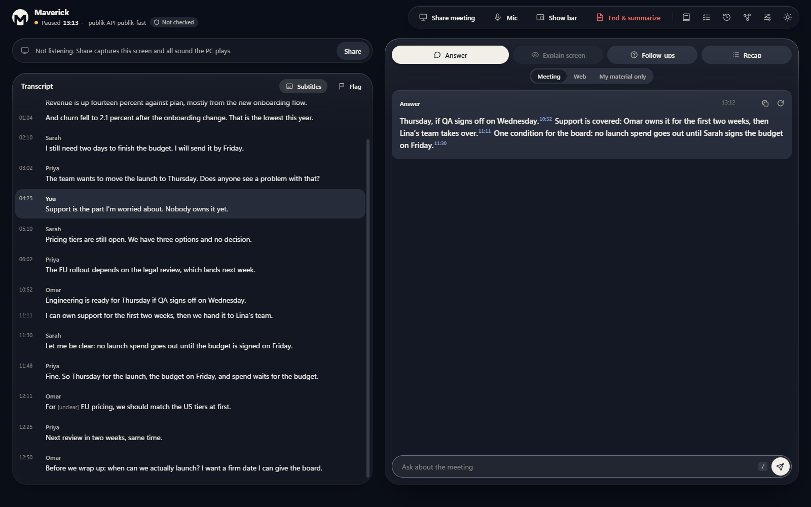

# Maverick

Maverick is an AI meeting copilot for Windows. It listens to your meeting and your mic, keeps a live transcript, and when you ask it, tells you what to say, explains what is on the shared screen, suggests follow-up questions and recaps the meeting so far. When the meeting ends it writes the notes: summary, decisions and action items, each tied to the line of the transcript it came from.

It works with Teams, Zoom, Google Meet and any other meeting app, because it listens to what your PC plays and reads what is on your screen. Nothing needs to be installed in the meeting app, and nobody in the meeting has to do anything.

It is local-first: with Ollama it runs entirely on your computer. You can also use a cloud model instead, with or without a key of your own.

## Download

Get the latest installer or the portable exe from [GitHub Releases](https://github.com/za3ter123/maverick/releases).

- `Maverick-Setup-<version>.exe` installs Maverick for your Windows user.
- `Maverick-<version>-portable.exe` runs without installing.

Maverick needs Windows 10 version 2004 or later, or Windows 11, 64-bit. The builds are not code signed yet, so Windows SmartScreen may ask you to confirm the first start (More info, then Run anyway).

## Choosing the AI

On first start Maverick looks for Ollama on your computer. Pick whichever of these suits you; you can change it any time in Settings, and each task (live answers, reasoning, vision, transcription, web) can use a different one.

| Option | What you need | Where your data goes |
|---|---|---|
| publik API | Nothing to paste. Say yes on the first-run screen. Priced per use from a publik balance that starts at $0.00; linking the computer to a publik account gives $0.05 of free use, once. | Through publik's servers to the model |
| Ollama | [Ollama](https://ollama.com) running on your computer, with `ollama pull gemma4:12b` (and `ollama pull embeddinggemma` for the Library). A recent GPU makes it much faster. | Stays on your computer |
| Your own key | An API key for OpenAI, Anthropic, Google Gemini, OpenRouter, DeepSeek, Groq, Mistral, xAI or Together, or a local OpenAI-compatible server such as LM Studio. | To that provider |
| Claude Code CLI | The `claude` command installed and signed in. Also powers Sources, Web. | To Anthropic, through the CLI |

If Ollama is not running and you have not set up anything else, the first-run checklist offers publik API, with what it costs and where prompts go. Say No and Maverick shows how to start Ollama instead. Your own connections are never replaced.

## Features

- Live transcript of the meeting and your mic, with speaker labels. Arabic, English, and both mixed in one sentence; Arabic lines read right to left. Optional subtitles translate each line.
- Answer: what to say to the question that was just asked, from the transcript so far.
- Explain screen: what the shared slide, document or code shows.
- Solve: explains and solves what is on the shared screen, such as a bug, a formula or a question in a document, with the working shown. Useful for work and study.
- Follow-ups and Recap, and Think harder to redo any answer with a stronger model.
- Flag a moment, then End and summarize: notes with summary, decisions, action items and your flagged moments, each linked to its transcript line. Copy them or save them as Markdown.
- Sources: answer from the meeting, from the web (through the Claude Code CLI), or only from your own files with page citations that are checked against the files.
- Library: add PDFs, Word files, images and text; scanned pages are read by the vision model.
- Homework: reads a worksheet and drafts answers with the working, from your material or the web, for you to review. It can open a web form in a normal window you watch, fill in the answers you approved, and submit only when you say yes.
- Memory: a Markdown note for each meeting and homework, with links, in a folder you can open in Obsidian.
- Recording, off by default: audio, or audio and screen, saved to a folder you pick.
- History: every meeting with its transcript, answers and notes, searchable.
- The bar: a small always-on-top toolbar for the actions, so you never leave the meeting app. Light and dark themes.

## Hotkeys

They work from any app. Change them in Settings, Hotkeys.

| Keys | What it does |
|---|---|
| Ctrl+Shift+Enter or Ctrl+Shift+1 | Answer |
| Ctrl+Shift+2 | Explain screen |
| Ctrl+Shift+5 | Solve what is on the shared screen |
| Ctrl+Shift+6 | Smart assist: picks Answer, Explain screen or Solve |
| Ctrl+Shift+3 | Follow-ups |
| Ctrl+Shift+4 | Recap |
| Ctrl+Shift+T | Think harder |
| Ctrl+Shift+F | Flag this moment |
| Ctrl+Shift+Space | Type a question in the bar |
| Ctrl+\ | Show or hide the bar |
| Ctrl+Shift+0 | Open the main window |

Plain Ctrl+Enter is left alone because Teams sends messages with it. Inside Maverick's own windows, Alt 1 to Alt 5, `/` and Esc also work.

## Privacy

Stays on your computer:

- transcripts, answers, notes, History and settings, in the app's own storage
- your Library files themselves, in the app's own storage
- API keys, encrypted with your Windows account (DPAPI)
- Memory notes, in a folder under the app's profile
- audio and screen recordings, only when you turn recording on in Settings; otherwise audio is never saved to disk

Goes to a cloud provider, only for the tasks you put on one:

- the transcript text, your question and screen frames, for answers and screen reads
- short audio chunks, if transcription runs in the cloud
- Library pictures and scanned pages, if the Vision role runs in the cloud, so it can read them
- Library passages, when an answer uses your files, to the Live role's provider
- worksheet text for Homework, to the provider that drafts the answers
- with Sources, Web: your question and the meeting context, to Claude through the Claude Code CLI

With publik API:

- the requests above, for every task you put on publik, pass through publik's servers to the model. publik says it does not train on them and keeps no request bodies beyond a 24-hour idempotency fingerprint ([publikhq.com/developers](https://publikhq.com/developers)).
- when Live answers run on publik, search runs there too: the full text of every file you add to the Library, page by page, the text of your Memory notes when Memory is searched, and each search question are sent to publik to make search vectors. With Ollama this happens on your computer.
- setting it up sends publik this computer's name, Windows and its CPU type, the Maverick version and a random install ID, which publik uses to link the computer to an account.
- the publik key is kept by the desktop app at `%LOCALAPPDATA%\publik\apps\maverick.json` and never reaches the app's page.

When every task runs on Ollama, the header says "on this PC". The header also counts how many bytes each meeting sent off your computer.

Maverick keeps itself out of screen shares and screenshots with Windows content protection, the same flag password managers use. It is on by default; turn it off in Settings, Desktop app.

## Build from source

See [CONTRIBUTING.md](CONTRIBUTING.md) for running from source, the architecture and the tests.

## License

MIT, see [LICENSE](LICENSE). Third-party components are listed in [THIRD-PARTY-NOTICES.md](THIRD-PARTY-NOTICES.md).
